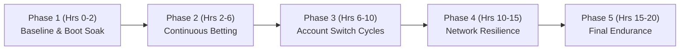

# FUN TARGET — 10 TO 20-HOUR CONTINUOUS STABILITY TEST PLAN
**Test Standard:** Production Endurance & Zero-Degradation Certification  
**Target Hardware:** T-95 Android TV Box (Allwinner H6, Mali GPU, 1GB RAM)  
**Execution Objective:** Validate 1,200 Continuous Game Rounds (20 Hours) Without Freezing, Black Screens, or Memory Leaks

---

## 1. Test Architecture & Phased Schedule

The 20-hour soak test is divided into 5 distinct evaluation phases designed to stress every subsystem of the application:



### Phase Schedule Breakdown:

| Phase | Time Window | Rounds | Core Focus & Verification Target |
| :--- | :--- | :--- | :--- |
| **Phase 1: Baseline Ramp-Up** | Hours 0 – 2 | 120 rounds | Measure initial memory plateau. Confirm baseline `TOTAL PSS` $\le$ 195 MB. |
| **Phase 2: Continuous Gameplay** | Hours 2 – 6 | 240 rounds | Verify steady-state rendering. Confirm 0 frame drops, wheel completes on time (54s). |
| **Phase 3: Account Switching Stress** | Hours 6 – 10 | 240 rounds | Switch accounts every 30 minutes (`demo2` $\to$ `demo1` $\to$ `demo2`). Verify 0 texture double-buffering. |
| **Phase 4: Network Chaos & Recovery**| Hours 10 – 15 | 300 rounds | Simulate intermittent Wi-Fi drops. Verify `useTimer` recovery without spurious 26s spins. |
| **Phase 5: Endurance Certification** | Hours 15 – 20 | 300 rounds | Cumulative 1,200 rounds. Confirm zero black textures, zero memory growth, zero crashes. |

---

## 2. Automated Long-Run Monitoring Script

To monitor the Android TV Box autonomously over the full 20-hour duration, execute this PowerShell monitoring script. It records timestamps, memory metrics, and CPU usage into `soak_test_log.csv` every 60 seconds:

```powershell
# File: run_soak_test.ps1
$device = "192.168.1.64:5555"
$pkg = "com.funtarget.app"
$logFile = "soak_test_log.csv"

Write-Host "Starting 20-Hour Stability Test on $device..."
"Timestamp,Total_PSS_kB,Native_Heap_kB,GL_mtrack_kB,CPU_Percent" | Out-File -FilePath $logFile -Encoding utf8

$startTime = Get-Date
$targetHours = 20

while ((Get-Date) -lt $startTime.AddHours($targetHours)) {
    $now = Get-Date -Format "yyyy-MM-dd HH:mm:ss"
    
    # 1. Capture memory dump
    $memDump = adb -s $device shell dumpsys meminfo $pkg
    
    $totalPss = ($memDump | Select-String "TOTAL PSS:\s+(\d+)" | ForEach-Object { $_.Matches.Groups[1].Value })
    $nativeHeap = ($memDump | Select-String "Native Heap\s+(\d+)" | ForEach-Object { $_.Matches.Groups[1].Value })
    $glMtrack = ($memDump | Select-String "GL mtrack\s+(\d+)" | ForEach-Object { $_.Matches.Groups[1].Value })
    
    # 2. Capture CPU usage
    $cpuDump = adb -s $device shell top -n 1 -b | Select-String $pkg
    $cpu = ($cpuDump -split '\s+')[8]
    if (-not $cpu) { $cpu = "0.0" }
    
    $logLine = "$now,$totalPss,$nativeHeap,$glMtrack,$cpu"
    $logLine | Out-File -FilePath $logFile -Append -Encoding utf8
    Write-Host "[$now] PSS: $totalPss kB | GL: $glMtrack kB | CPU: $cpu%"
    
    Start-Sleep -Seconds 60
}

Write-Host "20-Hour Stability Test Complete! Results saved to $logFile"
```

---

## 3. Strict Pass / Fail Certification Criteria

To achieve **Official Production Certification**, the build must satisfy all the following criteria without exception over the 20-hour window:

| Evaluation Metric | Acceptance Criteria (PASS) | Rejection Criteria (FAIL) |
| :--- | :--- | :--- |
| **Total Crashes / Force Closes** | **0 crashes (0.00%)** | $\ge 1$ crash or ANR |
| **Black Images / Glitches** | **0 occurrences** | Any black texture box observed |
| **UI Freeze / Lockup** | **0 occurrences** | App unresponsive for > 2 seconds |
| **Memory Growth Trend** | Flat curve ($\Delta \le 15$ MB across 20 hrs) | Monotonic climb $> 50$ MB |
| **Account Switching Peak** | Flat plateau ($\le 195$ MB after switch) | Memory jumps $> 300$ MB |
| **Mid-Round Wheel Spins** | **0 occurrences** | Wheel starts at 26s or any second $\ne 00$ |
| **Wheel Stopping Determinism** | Stops precisely at 54s countdown | Wheel continues past 53s or fails to stop |
| **Clock Synchronization Drift** | Within $\pm 500$ ms of backend IST clock | Drift $> 2000$ ms |

---

## 4. Remediation Runbook for Environmental Edge Cases

1. **If Wi-Fi drops on TV box during gameplay:**
   - App enters offline mode; countdown continues smoothly.
   - When Wi-Fi reconnects, `syncWithServer()` executes safely without overlapping requests.
   - Clock adjusts smoothly; boundary guard suppresses spurious wheel spins.
2. **If TV screen turns off (HDMI power saving):**
   - Native `onVisibilityChange` pauses audio and halts rAF loops immediately.
   - When screen turns back on, game state resumes cleanly.
3. **Emergency Manual Reload Shortcut:**
   - Press **Shift + R** on any USB / Bluetooth TV keyboard or air mouse to reload the game instantly without opening app settings.

