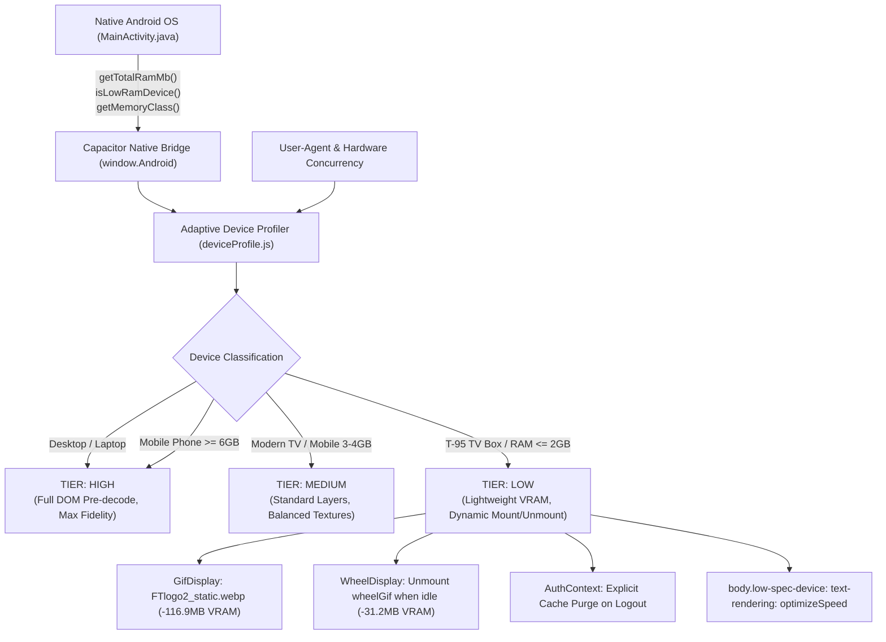

# FUN TARGET — ADAPTIVE RENDERING ARCHITECTURE
**Target Strategy:** Multi-Tier Dynamic Resource Allocation for Long-Running Gaming  
**Platforms Supported:** Android TV (Low/Mid/High), Android Mobile, Desktop Web  
**Core Philosophy:** Dynamic Adaptability Without Visual Compromise

---

## 1. Architectural Philosophy & Strategy

Traditional web-based games built for high-performance desktop browsers frequently degrade or crash when deployed to low-cost Android TV set-top boxes (e.g., T-95, X96 Mini, TX3). The primary cause is not JavaScript execution speed, but **uncompressed texture memory saturation (VRAM)** within the WebView's Chromium compositor.

The **Adaptive Device Performance Engine** dynamically interrogates the host operating system at boot time to measure physical hardware constraints. It categorizes the device into an operational tier and selects the optimal rendering strategy at runtime.

---

## 2. Hardware Classification & Tier Evaluation Rules

The engine implements a hierarchy of capability signals, giving priority to authoritative native Android telemetry over unreliable browser user-agent heuristics:

### Evaluation Hierarchy:
1. **Native Telemetry (Priority 1 - Most Reliable):**
   - Injected by `MainActivity.java` via `@JavascriptInterface` onto `window.Android`.
   - `getTotalRamMb()`: Total physical RAM via `ActivityManager.MemoryInfo.totalMem`.
   - `isLowRamDevice()`: Android OS flag `ActivityManager.isLowRamDevice()` (identifies Android Go or low-RAM configurations).
   - `getMemoryClass()`: Dalvik/ART heap limit per application in MB.
   - `isAndroidTV()`: UI mode check `UI_MODE_TYPE_TELEVISION`.
2. **Web Capabilities (Priority 2 - Fallback for Desktop/Mobile Browsers):**
   - `navigator.deviceMemory`: Hardware memory class in GiB.
   - `navigator.hardwareConcurrency`: Logical CPU core count.
   - `navigator.userAgent`: Platform detection (Desktop Windows/Mac vs. Android Mobile vs. Android TV).

### Classification Matrix:

| Classification Parameter | Tier: LOW | Tier: MEDIUM | Tier: HIGH |
| :--- | :--- | :--- | :--- |
| **Target Hardware** | T-95 TV Box, Allwinner H6/H616, Mali-450 | Standard Smart TVs, FireTV Stick 4K | Desktop PC, Mac, Flagship Mobile |
| **Physical System RAM** | $\le$ 2200 MB (1GB–2GB) | 2500 MB – 4500 MB (3GB–4GB) | $\ge$ 6000 MB (6GB–32GB) |
| **Native `isLowRamDevice()`** | `true` | `false` | `false` |
| **Platform Identifier** | Android TV / Box | Android TV / Mobile | Desktop Browser / High Mobile |
| **VRAM Consumption Cap** | **< 60 MB** | < 140 MB | Unlimited (> 250 MB) |
| **`FTlogo2` Rendering** | `FTlogo2_static.webp` (1.98 MB) | `FTlogo2.webp` (118.8 MB) | `FTlogo2.webp` (118.8 MB) |
| **`wheelGif` Rendering** | Mounted strictly when spinning | Mounted strictly when spinning | Kept in DOM pre-decoded |
| **Timer Blinking GIF** | Mounted only at 5, 4, 3s | Mounted only at 5, 4, 3s | Mounted only at 5, 4, 3s |
| **Texture Purge on Logout** | Native + JS Purge | Native + JS Purge | Standard JS GC |

---

## 3. Tier-Specific Rendering Strategies

### Strategy A: Tier LOW (Low-Configuration Android TV)
- **Problem Solved:** Prevents Mali GPU slab exhaustion (128 MB) and Linux kernel dirty page swap thrashing.
- **Implementations:**
  1. **Static Optimized Logo (`GifDisplay.jsx`):**
     Replaces 60-frame looping animation with `FTlogo2_static.webp`. Visually identical to frame 0 of the logo. Reduces VRAM allocation from **118.88 MB to 1.98 MB** (saving 116.9 MB).
  2. **Dynamic Wheel GIF Mount/Unmount (`WheelDisplay.jsx`):**
     Instead of maintaining 241 frames of `joker_gif1_slow.webp` hidden in DOM during the 54 seconds of betting, the element is unmounted. It mounts exclusively during the 6-second spin phase. Chromium automatically reclaims the **31.23 MB VRAM** during betting.
  3. **Zero Inactive Compositing:**
     Layers that are not actively moving avoid persistent `will-change: transform` or `translateZ(0)` declarations to minimize backing store memory in Skia/Chromium.
  4. **Active Cache Eviction on Account Change (`AuthContext.jsx`):**
     Explicitly clears `window.__permanentImageCache`, disconnects Web Audio nodes, and triggers native WebView `clearCache(true)`.

### Strategy B: Tier MEDIUM (Standard Android TV & Mid Mobile)
- Balances high visual dynamics with safe memory margins.
- Unmounts `wheelGif` during stationary betting to preserve a 50MB headroom for other system TV processes (Netflix, YouTube background services).

### Strategy C: Tier HIGH (Desktop & Flagship Devices)
- Maximizes responsiveness and zero-latency starts.
- Keeps all visual elements pre-decoded in DOM memory for instant 0ms synchronized animation starts.
- Full 60fps looping shines on banners and logos.

---

## 4. Fallback Architecture for Legacy WebViews (Chrome 74 / Android 9)

Many legacy Android TV boxes run older system WebViews (e.g. Chrome 74 or Android 9/10). The architecture handles legacy edge cases seamlessly:
1. **Dimension Parsing Fallback (`parseCssDimension`):**
   Chrome 74 does not reliably calculate CSS `min(...)` expressions inside CSS transform matrices. The custom `parseCssDimension()` utility converts `min(45vw, 58vh)` into deterministic pixel values using `window.innerWidth` and `window.innerHeight`.
2. **GPU Damage Rect Isolation:**
   In `WheelDisplay.jsx`, the spinning pointer GIF (`DG.gif`) is isolated in its own GPU layer outside the `scaleX` container. This prevents the Mali GPU rasterizer from producing clipping artifact glitches ("blinking golden boxes") around the wheel pointer.
3. **Visibility & Background Tab Recovery:**
   When the Android TV screen turns off or the input source switches (HDMI CEC switch), `document.visibilityState === 'hidden'` triggers an instant audio pause and wheel spin termination, preventing detached animation loops from consuming background battery and memory.

