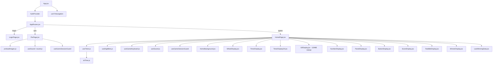

# PROJECT ARCHITECTURE & COMPONENT RELATIONSHIPS
**Project Name:** Fun Target (React 19 + Vite + Capacitor 8 Android TV / Mobile)  
**Workspace Root:** `D:\React Project\Fun Target React (pawan)\Fun Target React`  
**Date:** November 7, 2026  

---

## 1. Complete Directory Structure

```
Fun Target React/
│
├── build_apk/
│   └── FunTarget_Latest.apk               # Packaged Android debug APK for TV/Mobile
│
├── install_to_tv.bat                      # Wireless ADB installer script for Android TV
│
├── frontend/
│   ├── android/                           # Native Android Capacitor Project
│   │   ├── app/
│   │   │   ├── build.gradle               # Android application build configuration
│   │   │   └── src/main/
│   │   │       ├── AndroidManifest.xml    # Permissions, hardware acceleration, largeHeap
│   │   │       ├── java/com/funtarget/app/
│   │   │       │   └── MainActivity.java  # WebView tuning, keyboard suppression, native bridge
│   │   │       └── res/                   # Drawables, mipmaps, launcher banners
│   │   ├── build.gradle                   # Root Gradle script
│   │   └── gradlew.bat                    # Gradle build wrapper executable
│   │
│   ├── capacitor.config.json              # Capacitor settings (appId, scheme, splashscreen)
│   ├── package.json                       # Dependencies & scripts (React 19, Vite 5, Tailwind 3)
│   ├── vite.config.js                     # Vite bundler configuration & path aliases
│   ├── tailwind.config.js                 # Tailwind CSS design system rules
│   │
│   └── src/                               # Application Source Code
│       ├── main.jsx                       # React DOM root entry point
│       ├── App.jsx                        # Root App wrapper (Router, AuthProvider, Fullscreen, TV Nav)
│       │
│       ├── assets/                        # Static Media Assets
│       │   ├── font/                      # Digital-7, Bodoni, Cinzel, Century Gothic TTF fonts
│       │   ├── gamelist/                  # 16 lobby game thumbnail JPEG/WebP images
│       │   ├── sounds/                    # WAV/MP3 sound effects (TICK, SPIN, WIN, BET, etc.)
│       │   └── images/
│       │       ├── background/            # PrevBG.webp, prevImg.webp
│       │       ├── chip/                  # Chip values (1, 5, 10, 50, 100, 500, 1000, 5000)
│       │       ├── gifs/                  # FTlogo2.webp, joker_gif1_slow.webp, timerDisplay.webp, DG.gif
│       │       ├── home/                  # homeImg.webp (primary game background)
│       │       ├── login/                 # login-bg.webp
│       │       ├── numbers/               # 0.webp through 9.webp betting buttons
│       │       ├── panels/                # Panel coin overlays and glow states
│       │       └── wheel/                 # wheel.webp (high-resolution roulette wheel texture)
│       │
│       ├── components/
│       │   ├── common/
│       │   │   ├── FullscreenHandler.jsx  # Native browser / webview fullscreen controller
│       │   │   └── SoundToggle.jsx        # Audio mute / unmute toggle
│       │   └── layouts/
│       │       └── MainLayout.jsx         # Container layout wrapping HomePage
│       │
│       ├── constants/
│       │   ├── index.js                   # Storage keys, game identifiers
│       │   └── sounds.js                  # Audio event constants
│       │
│       ├── context/
│       │   └── AuthContext.jsx            # Authentication reducer, login/logout, session storage
│       │
│       ├── features/
│       │   ├── auth/
│       │   │   ├── components/
│       │   │   │   ├── GameLoadingOverlay.jsx
│       │   │   │   └── PointTransferModal.jsx   # Balance transfer between sponsor & player
│       │   │   └── pages/
│       │   │       ├── LoginPage.jsx            # User authentication form
│       │   │       └── PrePage.jsx              # Post-login game lobby with 16 games grid
│       │   │
│       │   └── home/
│       │       └── components/                  # In-Game Display Components
│       │           ├── ButtonDisplay.jsx        # OK Bet, Cancel, Prev, Exit control buttons
│       │           ├── ExitConfirmModal.jsx     # Exit confirmation modal dialog
│       │           ├── GifDisplay.jsx           # Bottom animated celebration banner (FTlogo2.webp)
│       │           ├── HomeBackground.jsx       # Static game table background (homeImg.webp)
│       │           ├── HomeOverlay.jsx          # Fullscreen 16:9 responsive container
│       │           ├── LastWinningData.jsx      # Top ribbon displaying last 10 round winners
│       │           ├── MessageDisplay.jsx       # Center prompt: "Bet Time Over", "Please Bet"
│       │           ├── NumberDisplay.jsx        # 10 betting buttons (0 to 9) & bet chips
│       │           ├── PanelDisplay.jsx         # Chip selector bar (1, 5, 10, 50, 100, 500, etc.)
│       │           ├── ScoreDisplay.jsx         # Real-time player balance display
│       │           ├── TimerDisplay.jsx         # Digital font countdown display (0:60 -> 0:00)
│       │           ├── TimerDisplayGif.jsx      # Casino flashing bulb border overlay (at 5,4,3s)
│       │           ├── TotalBetDisplay.jsx      # Cumulative placed bet counter
│       │           ├── WheelDisplay.jsx         # Animated Canvas/rAF rotating wheel & joker reveal
│       │           └── WinnerDisplay.jsx        # Winner digit and win payout announcement
│       │
│       ├── hooks/
│       │   ├── useAnimatedNumber.js       # Smooth score increment animation
│       │   ├── useAuth.js                 # AuthContext consumer hook
│       │   ├── useDigitBets.js            # Bet placement state management & calculations
│       │   ├── useGameKeyboard.js         # Hardware keyboard / TV remote key-code binding
│       │   ├── useGameSessionGuard.js     # Auto-logout on app blur / backgrounding
│       │   ├── useSound.js                # Sound effect playback hook
│       │   ├── useTimer.js                # Server-calibrated IST minute boundary hook
│       │   └── useTvNavigation.js         # Spatial D-Pad navigation for Android TV remotes
│       │
│       ├── pages/
│       │   └── HomePage.jsx               # Master Game Controller (Round lifecycle, bets, spin)
│       │
│       ├── routes/
│       │   ├── AppRoutes.jsx              # Route definition (/login, /pre, /game)
│       │   ├── ProtectedRoute.jsx         # Auth guard: redirects unauthenticated users to /login
│       │   └── PublicRoute.jsx            # Public guard: redirects logged-in users to /pre
│       │
│       ├── services/
│       │   ├── api.js                     # Axios HTTP client with interceptors
│       │   ├── auth.service.js            # Login, logout, balance transfer endpoints
│       │   ├── record.service.js          # Player betting history service
│       │   └── result.service.js          # Real-time draw result polling endpoint
│       │
│       ├── styles/
│       │   └── index.css                  # Tailwind directives and custom animation keyframes
│       │
│       └── utils/
│           ├── apiLog.js                  # In-memory logging of authentication API payloads
│           ├── closeApplication.js        # Cross-platform exit handler (Tauri, Capacitor, Browser)
│           ├── cn.js                      # Tailwind class merging utility
│           ├── deviceProfile.js           # Platform identification (Desktop vs Mobile vs TV)
│           ├── deviceUuid.js              # Hardware UUID generator
│           ├── istTime.js                 # Global standard IST clock & time synchronizer
│           ├── isTv.js                    # TV mode detection via aspect ratio and user agent
│           ├── pendingBet.js              # Persistent disk backup of in-flight bets
│           ├── preloadImages.js           # Static image warm-up & cache
│           └── sound.js                   # WebAudio AudioContext & HTML5 audio pipeline
```

---

## 2. Component Hierarchy & Dependency Flow



---

## 3. Critical Component Relationships & Lifecycles

### A. Navigation & Session Flow
1. **Login Phase:**
   `LoginPage.jsx` &rarr; `AuthContext.login()` &rarr; API Auth &rarr; `sessionStorage` populated &rarr; `navigate('/pre')`.
2. **Lobby Phase:**
   `PrePage.jsx` renders 16 game choices. Tapping "Fun Target" invokes `navigate('/game')`.
3. **Game Phase:**
   `HomePage.jsx` mounts, boots `useTimer` (100ms interval), binds audio, starts 60-second synchronized draw cycle.
4. **Account Switch / Exit Phase:**
   - User clicks `Exit` &rarr; `HomePage` unmounts &rarr; `navigate('/pre')`.
   - User clicks `Logout` &rarr; `PrePage` unmounts &rarr; `AuthContext.logout()` &rarr; `navigate('/login')`.
   - User logs in with next account &rarr; `navigate('/pre')` &rarr; `navigate('/game')` &rarr; `HomePage` mounts second instance.

### B. The Timing Engine Relationship
- `istTime.js`: Singleton module holding `serverOffsetMs` and global `syncGlobalTime` running on a 30s `setInterval`.
- `useTimer.js`: React hook subscribing to `istTime`. Ticks every 100ms. Reads `getNow()`, computes seconds remaining (`secondsToNextMinute`), and checks `targetMinuteRef.current !== currentMinute` to fire `handleNewMinute`.
- `HomePage.jsx`: Listens to `useTimer`. When minute boundary triggers, sets `wheelSpinning = true` and `spinCount++`.
- `WheelDisplay.jsx`: Listens to `spinTrigger` (`spinCount`). Runs a 60 FPS `requestAnimationFrame` loop that spins the wheel for 6.0 seconds and smoothly decelerates onto the server result.

